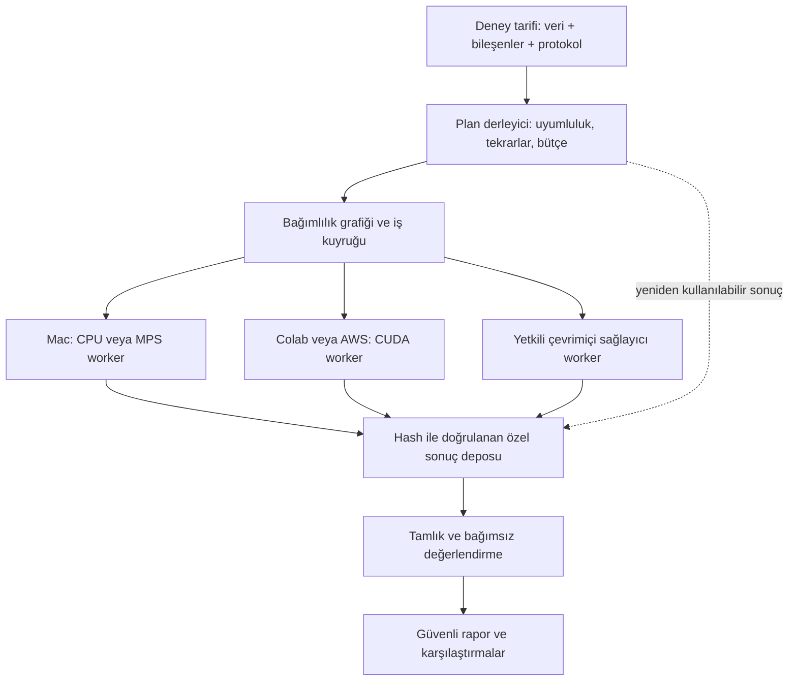

# Değiştirilebilir ve dağıtık RAG benchmark mimarisi

14 Ekim 2026 — araştırma ve tasarım önerisi. Deneyler kullanıcı isteğiyle durduruldu. Bu belge, örnek planlar ve kaynak incelemesi yeni bir çalışan altyapı veya tamamlanmış model entegrasyonu değildir. Mevcut sonuçlar ve protokoller değişmedi.

## Önerilen yön

Benchmark'ı belirli model adlarına bağlı bir deney kuyruğundan, **sürümlü bileşenler + açık deney planı + donanımdan ayrı yürütme katmanı** olan bir düzene taşıyalım. Mevcut doğrulanmış hesaplama kodunu sarmalayarak ilerleyelim; bütün sistemi başka bir framework ile yeniden yazmayalım.

Sabit kalan şey bilimsel karşılaştırmanın sözleşmesi olmalı: hangi kaynak, hangi sorgu, hangi adaylar, hangi ölçüm? Değiştirilebilir olanlar modeller, temsil yöntemleri, veri kümeleri ve deney senaryolarıdır. Adaptif olan bölüm işlerin uygun makinelere atanması, önbellek kullanımı ve önceden tanımlanmış sınırlar içindeki kapasite yönetimidir. Adaptif sistem, deney ortasında görünmez biçimde modeli veya ölçüm koşulunu değiştirmemelidir.

Bugün repo boş bir başlangıç değil: model adaptörleri, veri hazırlığı, RRF, skor/istek önbellekleri, kimlik doğrulama ve bağımsız ölçümler var. Eksik olan bunları ortak bir plan ve dağıtık yaşam döngüsüyle birleştirmek. [Dosya bazında mevcut sistem incelemesi](current-system-audit.md).

## Takıp çıkarılacak bileşenler

| Bileşen | Sorumluluğu | Değiştirme örneği |
|---|---|---|
| `DatasetProvider` | Sabit corpus, sorgu, qrel/cevap, kaynak grupları, erişim ve split manifesti | ViDoRe yerine yeni belge koleksiyonu; aynı koleksiyonda yeni dil |
| `Representation` | Metin çıkarma, OCR, chunk, ASR, caption, kare/ses penceresi | Sayfa görüntüsü yerine OCR metni; kodda ortak kayıpsız parçalama |
| `QueryTransform` | Sorgu öneki, çeviri veya genişletme | Genel arama öneki yerine kod öneki; ayrı koşul |
| `LexicalRetriever` | Tokenizasyon ve sözcüksel arama | BM25; ayrıca seçilmiş BM25+ protokolü |
| `EmbeddingProvider` | Sorgu ve belge için dense/sparse/token vektörleri | BGE, EG2 veya yeni yerel/API modeli |
| `Index/SearchBackend` | Vektör saklama ve arama işlemi | Exact cosine; ayrıca ölçülen ANN indeksi |
| `Fusion` | Kanal sıralamaları, aday bütçesi, eşitlik ve tekrar kuralları | BM25+BGE RRF; BM25+EG2; üçlü birleşim |
| `Reranker` | Sabit adayları yeniden sıralama | Cross-encoder, pointwise karar modeli veya listwise LLM |
| `DecisionScorer` | Tanımlanmış alaka/kanıt sorularını skorlamak | Laya, Jev, Clef; ayrıca bir reranker adaptöründe kullanılabilir |
| `EvidenceAssembler` | Kaynak seçimi/sırası, bağlam bütçesi, citation ID'leri | Top5 metin; Top5 görüntü; kaynak başına pencere politikası |
| `Generator` | Kaynaklardan cevap üretimi | Mevcut Gemma yerine başka yerel model veya API |
| `Evaluator` | Göreve uygun metrikler, kapsam, bağımlılık grupları | Retrieval, cevap doğruluğu, citation, insanla kalibre edilmiş judge |
| `Executor` | Aynı donmuş işi belirli ortamda çalıştırma | Yerel süreç, Colab, AWS worker, API istemcisi |

Embedding modeli tek başına arama sistemi değildir; temsil, sorgu/belge rolleri, benzerlik ve indeks ile birlikte tanımlanır. Karar modeli de cevap üreten LLM ile aynı sözleşmeye konmamalıdır. Listwise sıralayıcıda sonuç adayların tamamına ve sırasına bağlıdır; pointwise skoru aday çiftleri arasında yeniden kullanmak ancak tam istek kimliği eşleşirse geçerlidir.

Her eklenti ağırlık yüklemeden okunabilen bir manifest sunmalı: `id`, eklenti/API sürümü, model revision/hash, giriş/çıkış şeması, modaliteler, desteklenen görevler, tokenizer/prompt kimliği, boyut ve skor anlamı, maksimum girdi politikası, offline/online modu, gerekli kaynaklar ve lisans. Ayrı ortam veya container sayesinde çakışan Torch/Transformers sürümleri tek Python ortamına zorlanmaz. Geliştirme sırasında bilinen adaptör listesi yeterlidir; dış eklentiler sonradan sürümlü paket giriş noktalarıyla kaydedilebilir. Rastgele indirilmiş kod plan okuma sırasında çalıştırılmaz.

Yükleme, sıcak hazırlık, çalıştırma, tanı bilgisi toplama ve kapatma ayrı yaşam döngüsü adımları olmalı. Adaptörün gerçek cihaz/dtype, model sürümü, giriş kapsamı ve bitiş nedenini raporlaması zorunludur. Desteklemediği yeteneği açıkça reddeder; görüntüyü düşürmek veya CUDA yerine CPU kullanmak başarılı uyum sayılmaz.

## Model değiştirmek neyi yeniden çalıştırır?

| Değişiklik | Yeniden gereken iş | Korunabilecek sonuç |
|---|---|---|
| Yalnız cevap LLM'i | Cevap üretimi ve cevap değerlendirmesi | Aynı retrieval/rerank sıralamaları ve uygun kaynak paketleri |
| Yalnız reranker | Yeni skorlar, yeni sıralama; etkilenmiş QA | Aynı arama adayları, belge/sorgu vektörleri |
| Yalnız embedding modeli | O modelin ilgili sorgu/belge vektörleri, indeks, arama ve etkilenen aşağı akış | BM25 ve diğer değişmemiş kanallar |
| Yalnız sorgu öneki | Yeni sorgu vektörleri ve arama | Belge vektörleri, belge rolü değişmediyse |
| Yalnız fusion/K | Önbellekte yeterli derinlik varsa sıralama/bütçe hesabı; yeni aday çiftleri varsa eksik skorlar | Uygun kanal sıralamaları ve birebir eşleşen skorlar |
| Yalnız qrel veya cevap etiketi | Yeni etiket sürümüyle değerlendirme | Kaynak/girdi/istek değişmediyse çıkarım sonuçları |
| Chunk/OCR/caption/kare politikası | Etkilenen temsil ve bağımlı aşamalar | Değişmemiş ham kaynak ve bağımsız kanallar |
| Yeni corpus veya sorgular | Değişen girdiler ve global indeks/arama etkileri | Kimliği eşleşen öğe düzeyi vektörler; BM25 global istatistikleri yeniden hesaplanır |
| Donanım/dtype/batch/serving motoru | Beyan edilmiş yeni yürütme koşulu ve uygunluk kontrolü | Yalnız uyumluluğu kanıtlanan artifact; eski sayısal koşula yeniden etiketleme yok |

İki farklı embedding uzayının vektörleri doğrudan toplanmaz. Her kanal kendi uyumlu sorgu/belge uzayında arama yapar; sıralamalar RRF gibi açık bir fusion ile birleşir. Skor ağırlığı/normalizasyon öğrenilecekse geliştirme split'inde öğrenilir; test üzerinde seçilip başarı diye raporlanmaz. Exact arama ile ANN kalite/hız karşılaştırması ayrı senaryodur.

## Deney planı ve sonuç kimliği

Üç kayıt ayrılmalı:

1. **Bilimsel koşul:** veri/split, temsil, modeller, prompt, aday bütçesi, fusion, decoding, metrikler ve sayısal koşul.
2. **Çalıştırma denemesi:** worker, gerçek cihaz/ortam, zamanlar, yeniden deneme gerekçesi, kaynak tüketimi ve durum.
3. **Artifact:** giriş ve üretici kimlikleri, checksum, kapsam, tamamlanma ve bağımsız denetim durumu.

Yeni cache şeması içerik adresli olmalı. Media için host yolu yerine içerik hash'i + kaynak/öğe kimliği kullanılır; worker yerel dosyayı çözer. Eski cache anahtarları olduğu gibi okunur. Taşıma uğruna eski sonuçların kimliği değiştirilmez; geçiş ayrı, doğrulanmış bir eşleme gerektirir.

Plan derleyici önce bütün kombinasyonları ve dışlamaları gösterir, sonra ortak aşamaları tek düğümde toplar. Örneğin üç reranker ve iki LLM denenmesi belge embedding'ini altı kez üretmemelidir. K20/K50/K100 ve farklı fusion hücreleri için uygun **benzersiz sorgu–aday çiftleri** bir kez skorlanır. Listwise istekler ve farklı kaynak sırasındaki QA istekleri aynı anahtara indirgenmez. Cache kapasitesi/derinliği yetmeyen durumda eksik kısım açıkça planlanır.

Tamlık yüzdesinin paydası seçilmiş ve sürümlenmiş plana aittir. Yeni model eklenince eski tamamlanmış planın yüzdesi geriye dönük değiştirilmez; yeni plan ve kalan benzersiz işler ayrıca gösterilir. Eski ana matris, ayrı CUDA koşulları, teknik sağlık kontrolleri ve insan değerlendirmesi tek yanıltıcı toplamda birleşmez.

## Paralel ve adaptif yürütme

Başlangıç önerisi: **hafif bir coordinator + çekerek iş alan worker'lar + kalıcı artifact deposu**. Merkezi metadata/lease için Postgres, veri için S3 uyumlu depo; tek makine geliştirmesinde aynı arabirimin yerel sürümü. Canlı SQLite worker'a özel kalır; Drive/NFS üzerinden çoklu writer veritabanı olarak paylaşılmaz. Alternatifler ve resmî kaynaklar [dağıtık yürütme incelemesinde](distributed-execution-options.md).

Worker gerçek donanımını, VRAM/RAM/disk alanını, yazılım imajını, desteklediği backend'i ve yüklenmiş modeli bildirir. Planlayıcı uyumlu işi seçerken kaynak sınırını, veri/model yakınlığını, kuyruk yaşını ve ölçülmüş süreyi kullanır. Mac'te bir GPU işiyle CPU hazırlık/denetim eşzamanlı olabilir. Aynı MPS belleğine iki ağır modeli koymak ayrı kapasite kontrolü ister.

**Bir H100 = otomatik 20 eşzamanlı model değildir.** İlk varsayılan GPU başına bir ağır model sahibi olmalı. Ona çok sayıda kuyruk işi atanabilir; sunucu/adaptör destekliyorsa token uzunluğuna göre batch veya sürekli batching uygulanır. Birden fazla modeli birlikte yerleştirme ancak ağırlıklar + aktivasyon/KV + geçici bellek + güvenlik payı ölçüldüğünde açılır. Model bir GPU'ya sığıyorsa bağımsız replikalar veri paralelliği sağlar; model sığmıyorsa çoklu GPU tensor paralelliği farklı bir ihtiyaçtır. Bunların hızları model adına veya kart sayısına bakarak eşit varsayılmaz.

İlk dağıtım birimi sorgu shard'ı olsun: her shard aynı tam galeriye erişir. Vektör üretimi belge bloklarına; pointwise reranking benzersiz çiftlere; QA birebir isteklere bölünebilir. Galeriyi parçalayarak arama daha sonraki adımdır: BM25 global istatistikleri, tüm belge tokenlarıyla MaxSim, global topK/tie kuralı ve fusion öncesi global kanal sıralaması korunmalıdır. Yerel shard RRF'lerini birleştirmek aynı deney değildir.

Adaptasyon geliştirme/kapasite örnekleri üzerinde yapılır; başarı metriğine bakarak test koşulu seçilmez. Batch büyüklüğü sıralamayı değiştirebildiği için batch değişimi sessiz bir hız optimizasyonu kabul edilmez. Önceden test edilmiş koşullar arasından seçim yapıldığında hangi koşulun kullanıldığı artifact ve raporda kalır. Farklı cihaz koşullarından gelen parçalar onaylı eşdeğerlik protokolü olmadan tek koşul diye birleştirilmez.

İki çalışma profili bunu pratik kılar. **Referans profil**, mevcut baseline'ın kesin cihaz/batch/runtime kurallarını korur. **Adaptif dağıtım profili**, izin verilen cihaz ve batch havuzunu, kalite toleransını ve atama politikasını önceden tanımlayan ayrı bir deneydir. İkinci profil heterojen GPU'larda çalışabilir; rapor cihaz başına kapsamı, gerçek seçimleri ve politika sürümünü gösterir, kendini eski homojen baseline diye adlandırmaz. Modeller karşılaştırılırken uzunluk/cihaz dağılımı dengelenir veya eşleşmiş karşılaştırma yapılır; daha zor sorguları yalnız bir modele/makineye atamak gizli karıştırıcı olmamalıdır. Böylece adaptasyon mümkündür, fakat neyin ölçüldüğü belirsizleşmez.

İş kuyruğu atomik claim, süreli lease ve eski worker'ın sonuç yazmasını engelleyen fencing token kullanmalı. Hedef “tek kez inference yapıldığı” garantisi değil, tekrar çalışabilen sistemde **tek kabul edilmiş sonuç** olmalıdır. Aynı anahtar için çelişen çıktılar incelemeye alınır. API sağlayıcısı idempotency desteklemiyorsa bağlantı kopmasından sonra tekrar çağrı ek ücret ve farklı cevap üretebilir; belirsiz deneme kaybolmuş sayılmaz.

## Durma, hata ve kalıcılık

Önerilen durumlar: `planned → ready → leased → running → checkpointed → completed → verified → published`; ayrıca `paused`, `cancelled`, `failed`, `unsupported`, `blocked`. Çalışan süreç çıkması ile bağımsız doğrulama farklı olaylardır.

Kullanıcı dur dediğinde coordinator yeni claim'leri kapatır, owned worker'lara durma sinyali gönderir, çocuk süreçlerin gerçekten kapandığını doğrular, kapanmış immutable checkpoint'i depoya taşır ve checksum onayından sonra uygun runtime'ı bırakır. Derhal iptal isteniyorsa mevcut kayıp aralığı kayda geçer. Kernel interrupt veya CLI exit0 tek başına child cleanup değildir; bu çalışma sırasında bunun ayrımına ihtiyaç duyuldu.

Geçici ağ hatası sınırlı tekrar/backoff alabilir. Bellek hatası aynı büyük batch'in yüzlerce koşulda tekrar denenmesine yol açmamalı; koşul ailesinde circuit breaker açılmalı. Aynı protokolü taşıyabilen daha büyük worker varsa yeniden atama değerlendirilebilir. Model/dtype/batch/overflow değişikliği gerekiyorsa yeni koşul gerekir. Kimlik/checksum hatası otomatik repin ile onarılmaz.

Kaynak veriler, cevaplar ve veri taşıyan prompt'lar özel depoda; GitHub'da kod, sözleşmeler, güvenli aggregate ve kaynak hash'leri olur. API secret değerleri plan içinde değil secret referanslarında bulunur. Buluta çıkabilecek veri ve izinli sağlayıcılar açıkça tanımlanır. Offline modda hazırlık sonrası ağ erişimine ihtiyaç duyulmaması test edilir. Online modda model alias'ının gerçekte döndürdüğü sürüm, istek/yanıt, RPM/TPM, timeout ve ücret kaydedilir; sağlayıcı sürümü sabitlenemiyorsa karşılaştırmanın tekrar üretilebilirlik sınırı açıklanır.

## Hazır araçlardan ne alalım?

| Araç/yaklaşım | Burada kullanımı | Sınır ve öneri |
|---|---|---|
| Repo çekirdeği + kendi küçük sözleşmelerimiz | Mevcut ölçüm/provenance/özel modaliteleri korumak | İlk tercih; yeni bir genel amaçlı ML platformu yazmayalım |
| Haystack | Bileşen giriş/çıkış sözleşmeleri, pipeline entegrasyonu | İsteğe bağlı adaptör; bütün metrik/cache/protokolü ona devretmeyelim |
| BEIR | Retrieval dataset/adapter uyumluluğu ve karşılaştırma köprüsü | Mevcut 17 metrik, qrel, tie ve source-group kurallarının eşitliği ayrıca test edilir |
| LiteLLM | İsteğe bağlı online provider geçidi, kullanım ve bütçe takibi | Model fallback, parametre/media düşürme ve otomatik dönüşümler benchmark modunda kapalı veya açık koşul olmalı |
| Ray | Kararlı CUDA havuzunda resource-aware actor/task yürütme | Executor adaptörü olarak sonraki seçenek; kopabilen Colab'ı kalıcı cluster düğümü saymayalım |
| AWS Batch | İzole GPU container işleri ve kuyruklar | AWS ağırlıklı büyük havuz için seçenek; kota, veri aktarımı, kalıcı çıktı ve maliyet kontrolü ayrıca gerekir |
| vLLM | Desteklenen yerel LLM için batching sunucusu | Her model/karar/rerank backend'i otomatik desteklenmez; mevcut motorla yeni sayısal koşul olarak doğrulanır |

Haystack açık bileşen giriş/çıkışları ve paketlenebilir entegrasyonlar sunuyor; bu, ortak sözleşme yaklaşımını destekliyor. Bunun bizim bilimsel eşdeğerlik/audit katmanımızın yerine geçmesi tasarım önerimiz değildir. [Resmî Haystack bileşen belgeleri](https://docs.haystack.deepset.ai/docs/custom-components).

BEIR'nin retrieval/evaluation yapısı bir uyumluluk köprüsü için uygundur. Mevcut koddaki aynı-ID dışlama, cutoff ve metrik yuvarlama davranışları bizim protokole otomatik taşınmamalıdır. [BEIR](https://github.com/beir-cellar/beir), [değerlendirme uygulaması](https://github.com/beir-cellar/beir/blob/main/beir/retrieval/evaluation.py).

Kullanıcının “Cleft” diye andığı ürün için resmî kaynakta **Cloudflare Clef** bulundu. Clef typed sorulara seçenek olasılıkları döndürür. Bu yüzden `DecisionScorer` üzerinden alaka veya kanıt değerlendirmesine adaydır; doğrudan cevap LLM'i değildir. Doküman uzun text state'in kesilebildiğini belirtiyor; strict input-coverage adaptörü bu davranışı dikkate almalı. Pazarlanan gecikmeler bizim veri kümemizde ölçülmüş hız değildir. [Cloudflare Clef](https://developers.cloudflare.com/workers-ai/models/clef/).

Sağlayıcı girdinin tamamını işlediğini doğrulayacak tokenizer/sınır/diagnostic kanıtını vermiyorsa bu alan `unavailable` kalır. Böyle bir koşul “tam kaynak kapsamı doğrulandı” etiketini alamaz; yalnız açıkça belirtilen API protokolü olarak ölçülebilir.

LiteLLM'in Decisions belgeleri Jev/Clef gibi sağlayıcıları ortak typed endpoint altında topluyor; fakat media desteği, alan dönüşümü ve sürümler farklı. Dokümanda bazı seçeneklerle desteklenmeyen görüntülerin düşürülebildiği, Clef dönüşümünde metin/görüntü bitişikliğinin korunmadığı yazıyor. Bu nedenle ham isteğe eşdeğerlik testleri olmadan yalnız endpoint biçiminin aynı olmasını yeterli saymayalım. [Decisions API](https://docs.litellm.ai/docs/decisions), [routing](https://docs.litellm.ai/docs/routing). İnceleme tarihi 14 Ekim 2026; kurulumda seçilen tam sürüm yeniden pinlenir.

## Aşamalı uygulama ve kabul kapıları

| Adım | Somut teslim | Bitmiş sayılma koşulu |
|---|---|---|
| 0 — Bu değişiklik | Durdurma kaydı, mimari, seçenekler, senaryo kataloğu ve çalıştırılmayan örnek plan | Kaynak/claim incelemesi; yeni model veya cloud çalışması yok |
| 1 — Sözleşmeler | Registry, typed manifestler, legacy adapter sarmalayıcıları | Eski ve yeni sarmalanmış yol fixture'larda aynı request/cache/ranking/metrikleri verir |
| 2 — Plan derleyici | Dataset/model/protokol seçimi, DAG, benzersiz iş ve invalidation çıktısı | Ağırlık yüklemeden uyumsuz girdiler ve eksik revision'lar reddedilir |
| 3 — Worker yaşam döngüsü | Önce local executor, sonra remote pull worker; lease/stop/checkpoint | Kesinti, stale worker, çift claim, bozuk aktarım ve tekrar birleştirme testleri |
| 4 — Dağıtık doğruluk | Query/pair shard ve tam popülasyon merge | Bir worker ile iki worker kontrollü fixture sonuçları aynı; eksik/duplicate shard tam sayılmaz |
| 5 — Eklenti kanıtı | Bir yeni dataset, bir yeni embedding, bir decision scorer ve bir generator | Her biri contract test + daha sonra ayrıca yetkilendirilen gerçek sınırlı entegrasyon kontrolü |
| 6 — Yetkili çalışma | Seçilmiş senaryoların çoklu GPU/API yürütmesi | Plan gözden geçirilmiş; gerçek kapasite, bütçe, hata ve tahmin kaydı mevcut |

Önce bir büyük yeniden yazım, ardından bütün matrisi baştan çıkarım önerilmiyor. Her adım küçük commit'lerle eski runner'ın yanına eklenir; geçiş tamamlanana kadar eski protokol dondurulmuş referans olarak tutulur. `work/` altındaki tek seferlik operasyon yardımcıları ancak ürünleştirilip test edildikten sonra desteklenen `src/`/`tools/` alanına alınır.

Bir sonraki geliştirme başlangıcı için varsayılan önerim: repo çekirdeği + hafif pull worker; online sağlayıcılar adaptör; ileride ihtiyaç olduğunda Ray veya AWS Batch executor. İlk senaryolar embedding-only, reranker-only ve generator-only kontrollü karşılaştırmalar olmalı. [Senaryo kataloğu](scenario-catalog.tr.md) ve [çalıştırılmayan plan örneği](../../configs/examples/modular-benchmark.proposal.json) bu kararı somutlaştırır. Kullanıcı yeniden deney başlatma talimatı vermedikçe GPU/API işi yürütülmez.
